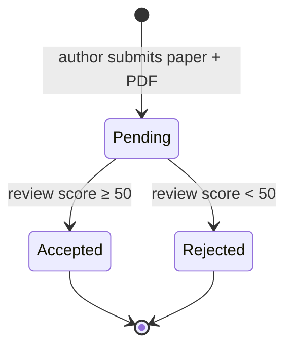

<div align="center">

# 🎓 Conference Management (KongreYönetim)

**Academic paper submission and peer review for conferences**


[Workflow](#-workflow) · [Features](#-features) · [Run it](#-run-it) · [Türkçe](#-türkçe)

</div>

---

Authors register and submit papers with an abstract and a PDF. A reviewer scores each paper,
and the paper's status updates automatically. The app is a compact, end-to-end example of an
ASP.NET Core MVC application with authentication, file uploads and relational data.

## 🔄 Workflow



## ✨ Features

- **Accounts** via ASP.NET Core Identity (register, log in, log out).
- **Paper submission** with title, abstract and a PDF upload stored under `wwwroot/uploads/`.
- **Peer review** with a 1–100 score and comments. Scores of 50 or more accept the paper and lower scores reject it.
- **Status tracking**: *Değerlendirme Bekliyor → Kabul Edildi / Reddedildi*.
- Full **CRUD** for papers and reviews (EF Core with migrations, SQL Server LocalDB).

## 🚀 Run it

Requirements: the .NET 10 SDK and SQL Server LocalDB.

```bash
cd KongreYonetim
dotnet ef database update     # creates the Identity and Papers/Reviews tables
dotnet run
```

> [!NOTE]
> The reviewer role is hard-wired to the account `admin@gmail.com` for the course demo.
> Register that address locally to see the review actions.

## 📁 Project structure

```
KongreYonetim/
├── Controllers/   HomeController, PapersController, ReviewsController
├── Models/        Paper (+ PaperStatus), Review
├── Data/          ApplicationDbContext, migrations
├── Views/         Papers, Reviews, Shared layout
└── wwwroot/       static assets (uploads are git-ignored)
```

## 🇹🇷 Türkçe

**KongreYönetim**, akademik kongreler için bildiri gönderme ve hakem değerlendirme sistemidir. Yazarlar
özet ve PDF ile bildiri yükler, hakem 1–100 arası puan ve yorum verir. 50 ve üzeri puan alan bildiri kabul,
altında kalan reddedilir. ASP.NET Core MVC, Identity, EF Core ve SQL Server ile geliştirilmiştir.

---

<div align="center"><sub>Built by <a href="https://github.com/Soap2647">Mert Yasin Yılmaz</a></sub></div>
